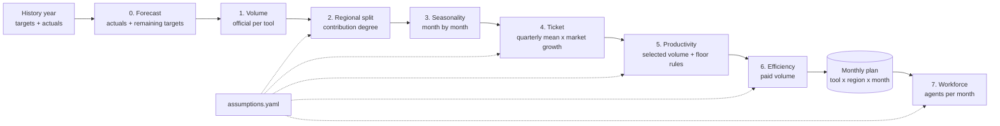

# Collection Plan Engine

  

A Python engine that builds an **annual debt-collection plan** for a utility: how many collection
actions each tool must execute, in each region and month, how much must be selected, how much cash
comes back, and how many field agents are needed to deliver it.

Every target is traceable: it comes from the history year plus a small set of explicit assumptions
kept in one YAML file. Every business rule has a unit test.

> All data in this repository is **synthetic** (a fictional utility, "Acme Power", with five regions).
> No real company data is included.

**Resumo em português** — veja [abaixo](#resumo-em-português).

---

## The problem

Collection teams usually plan the year in spreadsheets: dozens of tabs, hard-coded numbers and rules
that only one person understands. The questions are always the same:

* The corporate volume for each tool is fixed. **How do we split it across regions** without
  punishing regions that delivered and without inventing volume where there was none?
* **How much will each action collect** next year (ticket), given market growth?
* **How much do we need to select** to execute that volume (productivity), and **how much will be paid**
  (efficiency)?
* How do we keep the plan **coherent**: no region pulling the consolidated productivity below last year,
  and no plan that executes smaller debts than the ones it selects?
* **How many field agents** does it take, given that some actions can only run Monday to Thursday?

This engine answers all of them in a reproducible pipeline.

## Pipeline



| Step | Rule (short) | Module |
|---|---|---|
| 0. Forecast | actuals up to the cut-off month + targets for the rest of the year | `forecast.py` |
| 2. Regional split | share of last year's target; regions below target get `share x (1 + w x gap)`; normalised | `allocation.py` |
| 3. Seasonality | annual volume x normalised monthly curve of the tool group | `seasonality.py` |
| 4. Ticket | mean of the quarterly tickets (quarters with too few executions ignored) x (1 + market growth) x target factor | `ticket.py` |
| 5. Productivity | forecast + gain; consolidated cannot fall below the forecast; value productivity >= qty productivity | `productivity.py` |
| 6. Efficiency | forecast + gain; per-region overrides; new tools borrow from a reference tool | `efficiency.py` |
| 7. Workforce | volume / (business days x actions per day), per calendar, rounded up by region | `workforce.py` |

The full method, with the reasoning behind each rule, is in [docs/methodology.md](docs/methodology.md).

## Quick start

```bash
git clone https://github.com/<your-user>/collection-plan-engine.git
cd collection-plan-engine
python -m venv .venv && .venv\Scripts\activate      # Windows  (Linux/macOS: source .venv/bin/activate)
pip install -e ".[dev]"

collection-plan generate-data      # writes data/raw/history.csv (synthetic, seed 42)
collection-plan run                # writes the plan to outputs/
pytest                             # 26 tests
```

Without installing: `set PYTHONPATH=src` and use `python -m collection_plan ...`.

### Output

```
                       qty_plan ticket_plan eff_value_plan paid_fc_MM paid_plan_MM    delta
tool
field_disconnection      46,770       2,113          47.8%       45.4         47.2    +4.0%
re_disconnection          9,786      13,061           5.8%        2.8          7.4  +169.3%
special_notice          107,001       1,053          54.5%       64.5         61.4    -4.8%
remote_disconnection     28,324         760          60.4%        3.8         13.0  +239.8%
field_visit              82,423       1,500          24.2%       22.5         30.0   +33.4%
symbolic_disconnection   19,670         760          38.6%        0.0          5.8      new
digital_notice           25,341       1,053          38.0%        0.0         10.1      new
TOTAL                   319,315       1,648          33.3%      139.0        175.0   +25.9%
```

Files written to `outputs/`:

| File | Content |
|---|---|
| `plan_monthly.csv` | tool x region x month: executed, selected and paid (qty and value), ticket, productivity, efficiency |
| `plan_summary.csv` | annual totals per tool, forecast vs plan |
| `workforce_by_group.csv` | agents per team and month (exact and rounded up) |
| `workforce_by_region.csv` | agents per team, region and month |

## Using it as a library

```python
import pandas as pd
from collection_plan import load_config, run_plan

cfg = load_config("config/assumptions.yaml")
history = pd.read_csv("data/raw/history.csv", parse_dates=["month"])
result = run_plan(history, cfg)

result.summary()                               # forecast vs plan per tool
result.tools["field_visit"].shares             # regional split, with gap and weights
result.tools["field_visit"].productivity.table # productivity before/after each rule
```

## Project layout

```
config/assumptions.yaml    every assumption the engine uses (gains, curves, targets, calendars)
src/collection_plan/       the engine, one module per step
tests/                     unit tests per rule + integration tests on the full plan
docs/                      methodology and design decisions
data/                      synthetic history (generated, not versioned)
```

## Tests

The tests encode the business rules, so a change that breaks a rule fails the build:

* regional shares sum to 100%; regions below target get more; excluded regions get nothing;
* monthly volumes add back to the official annual volume;
* the ticket factor hits the target average ticket exactly;
* consolidated productivity never falls below the forecast;
* the selected ticket never exceeds the executed ticket (largest debts first), per region and per tool;
* business-day calendars, including "no holiday and no holiday eve" rules;
* agents are always rounded up, and the regional sum is never below the consolidated need.

## Roadmap

- [x] Engine, synthetic data, CLI and tests
- [ ] Excel report (one sheet per step, formatted)
- [ ] Interactive HTML report walking through each step
- [ ] GitHub Actions (lint + tests on every push)

---

## Resumo em português

Motor em Python que monta o **plano anual de cobrança** de uma distribuidora fictícia: quanto cada
ferramenta (corte, reaviso, visita etc.) executa por região e mês, quanto precisa selecionar, quanto
volta em pagamento e quantos agentes de campo são necessários.

* **Forecast** do ano-base = realizado até o mês de corte + meta dos meses seguintes.
* **Distribuição por região** pelo grau de contribuição: quem ficou abaixo da meta recebe um peso extra
  proporcional ao gap; quem entregou não é pressionado.
* **Sazonalidade** oficial por grupo de ferramentas.
* **Ticket** = média dos tickets trimestrais × crescimento de mercado × fator do ticket alvo.
* **Produtividade e eficiência** = forecast + ganho, com travas: o consolidado não piora e o ticket
  selecionado nunca supera o executado (maiores débitos primeiro).
* **Dimensionamento de agentes** com calendários diferentes por ferramenta (ex.: só de segunda a
  quinta, sem feriado e véspera).

Todas as premissas ficam em `config/assumptions.yaml`, cada regra tem teste automatizado e os dados são
100% sintéticos.

## License

MIT
